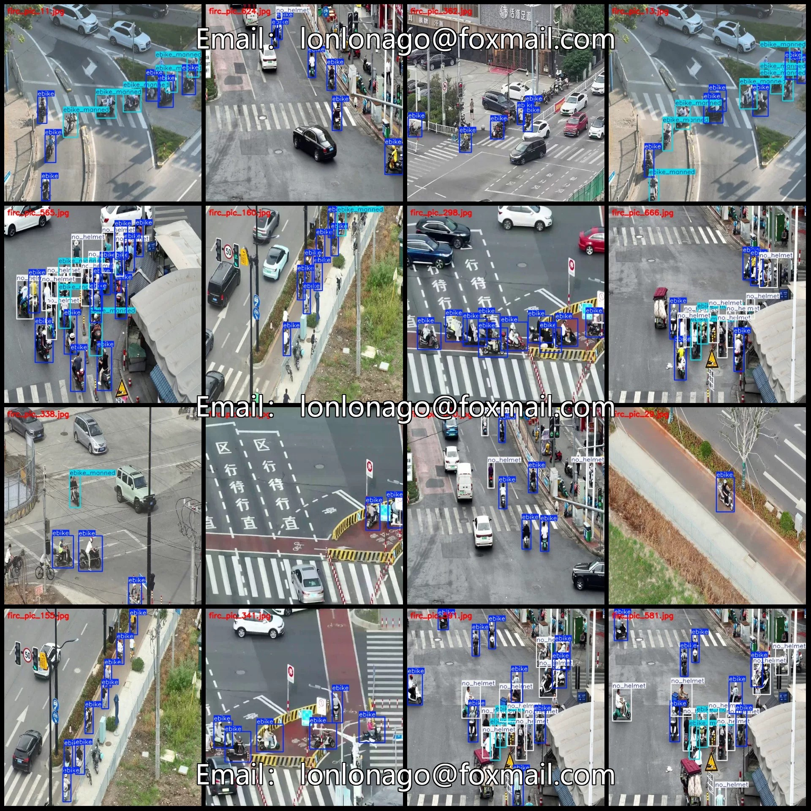
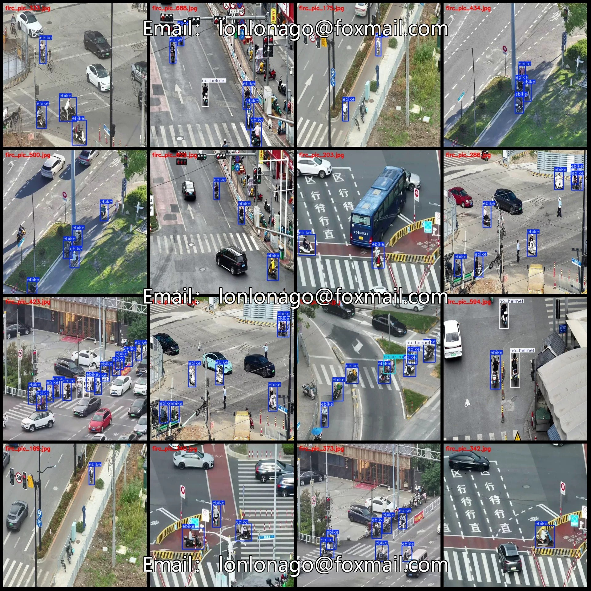
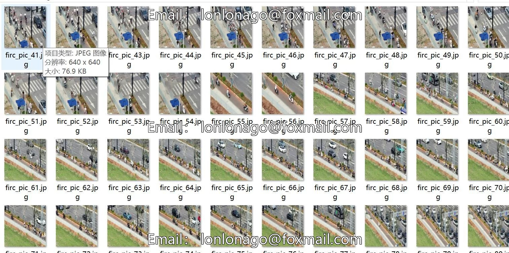
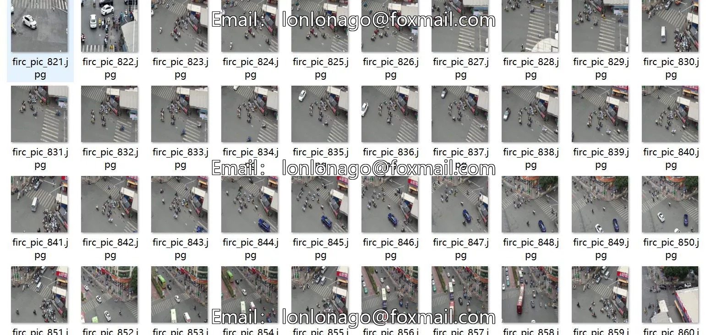

# Drone-view aerial photography of urban streets with detection of electric vehicle passengers dataset VOC+YOLO format

## Body

Drone-Viewpoint Aerial Photography City Streets E-Bike Human Detection Dataset VOC+YOLO Format 1008 Images in 3 Categories
Warm Reminder: Due to the dataset's replicability, please confirm compliance with requirements before purchasing.
Dataset Format: Pascal VOC format + YOLO format (txt file without split paths, only containing jpg images and corresponding VOC format xml files and yolo format txt files)
Number of Images (Total jpg files): 1008
Number of Annotations (Total xml files): 1008
Number of Annotations (Total txt files): 1008
Number of Annotation Categories: 3

Annotation Category Names (Note that the order of categories in the Yolo format does not correspond to this, but is based on the labels folder's classes.txt): ["ebike", "ebike_manned", "no_helmet"]
Number of boxes per category
ebike (electric bike) = 4861
ebike_manned (electric bike with passengers) = 573
no_helmet (without helmet) = 1663
Total number of boxes = 7097
Number of images per category
ebike (electric bike) = 1001
ebike_manned (electric bike with passengers) = 269

No_helmet (Not wearing a helmet) has 436 images.
Image resolution: 640x640
Labeling tool used: labelImg
Labeling rules: Draw a rectangle around the category.
Important note: The dataset does not have separate training, validation, and test sets; you need to partition them yourself.
Special statement: This dataset does not guarantee the accuracy of the trained model or weight files.

## Images

## Payment

Here is a pay link on Stripe ( https://buy.stripe.com/3cs8yP7sY87d0vu9AB ). Please contact me lonlonago@foxmail.com after funding $89, and I will send you a complete data files , thank you!

